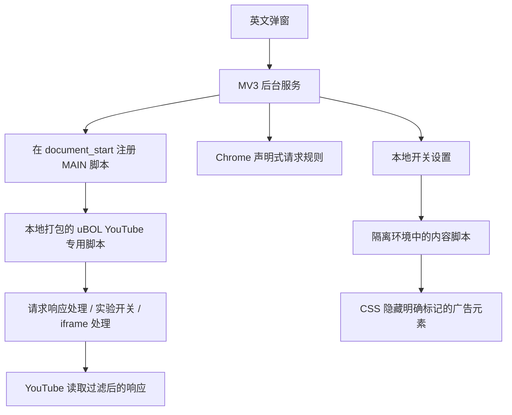

# TubeQuiet

[English](README.md) | **简体中文**

专注于 YouTube 的 Chrome Manifest V3 扩展，插件界面为英文。0.2.0 是开发版本，广告过滤效果可能受 YouTube 实验功能和服务端广告影响。发布前请查看[验证记录](docs/VALIDATION.md)（英文）。

## 0.2.0 更新

更新 YouTube 反检测应对：引入限定到 YouTube 的 uBOL 专用脚本与广告状态替代脚本。当前 Chrome 样本未出现停用屏蔽器提示，具体改动与验证边界见[更新记录](CHANGELOG.md)和[验证记录](docs/VALIDATION.md)。

## 安装

**[中文安装指南（从 GitHub 下载到安装）](docs/INSTALL.zh-CN.md)** — 从 GitHub 自行下载并安装到 Chrome，无需编程。

## 开发环境安装

1. 在没有启用其他广告拦截器的 Chrome 个人资料中打开 `chrome://extensions`。
2. 开启开发者模式，点击 **加载已解压的扩展程序（Load unpacked）**，选择本仓库的 `extension` 目录。
3. 从扩展菜单打开 TubeQuiet，然后刷新 YouTube 标签页。
4. 使用开关开启或关闭过滤。切换后，已打开的 YouTube 标签页会自动刷新。
5. 隐私和源码说明可通过 Chrome 中的扩展 **选项（Options）** 查看。

要求 Chrome 120 或更新版本，支持电脑端访问 `www.youtube.com`、`youtube.com` 和 `m.youtube.com`。不承诺支持 YouTube Music、Studio、第三方网站内嵌播放器、付费内容解锁或视频作者的赞助片段。

## 开发

需要 Node 22 或更新版本及 Python 3；无需执行 npm install，也没有运行时依赖。

```sh
npm test
npm run check
npm run package
```

`extension/` 内是可读、可直接运行的源码。商店安装包 ZIP 的根目录包含 `manifest.json`；`dist/` 同时包含对应源码包和 SHA256SUMS 校验文件。GitHub CI 执行相同检查。修改文件后，在 Chrome 中重新加载扩展，再刷新 YouTube。

## 架构



采用 uBOL 2026.914.1325 的 YouTube 专用脚本绑定，处理广告字段、特定请求参数、实验开关和 iframe API 绕行。八条本地网络规则包含优先于阻断的广告状态替代脚本。旧手写过滤器保留作历史参考，不再注入。弹窗检查实际的脚本注册和规则集状态，不提供虚构的拦截计数。CSS 遵循本地设置；切换后，后台服务刷新支持的 YouTube 标签页，使页面脚本也应用新设置。刷新失败时会在弹窗中提示。

没有服务器、统计分析、远程执行代码、账号系统或远程下载的规则解释器。本地只存储一个布尔开关设置。YouTube 响应数据仅在内存中检查，TubeQuiet 不会将其传出。

## 发布材料

- [上架清单](docs/PUBLISH.zh-CN.md)
- [商店介绍和权限说明](store/LISTING.md)（英文）
- `extension/privacy.html`：插件内的隐私与源码说明（英文）
- `store/PRIVACY.md`：公开隐私政策草稿（英文），托管前填写发布者联系信息
- `store/assets/`：小宣传图；`scripts/make-assets.py` 用于生成插件图标
- [验证记录与发布条件](docs/VALIDATION.md)（英文）

## 许可证与参考来源

使用 GPL-3.0-or-later。过滤方法以及字段、选择器研究参考了 uBlock Origin / uBlock Origin Lite，本版本包含其 YouTube 专用脚本运行时和广告状态替代脚本，并保留归属说明。具体版本见 [THIRD_PARTY_NOTICES.md](THIRD_PARTY_NOTICES.md)（英文）。分发的扩展包含可读源码及 GPL 许可证；发布时须保留许可证和归属说明，并向接收者提供对应源码及 GPL 授予的权利。开发仓库是否私有不改变分发义务。TubeQuiet 独立于 Google、YouTube 和 uBlock Origin。
